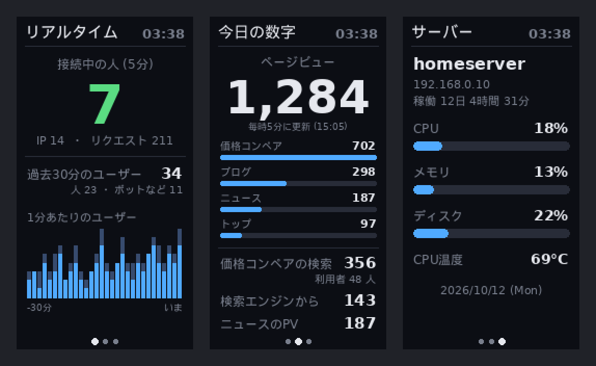

# acemagic-s1-lcd

ACEMAGIC のミニ PC（S1 系）の前面にある小さな液晶（320×170）と LED を、Linux から動かすための Python スクリプトです。

液晶には好きな画像を出せます。標準では、サーバーの状態（CPU・メモリ・ディスク・CPU 温度・稼働時間）を縦向きで表示します。



## 対応している機種

`lsusb` で次の 2 つが見える機種です。Intel N97 の ACEMAGIC のミニ PC（Ubuntu 24.04）で動作を確認しています。

```
ID 04d9:fd01 Holtek Semiconductor, Inc.        ← 液晶
ID 1a86:7523 QinHeng Electronics CH340 serial  ← LED
```

## しくみ

液晶と LED の通信のしかたは、[tjaworski/AceMagic-S1-LED-TFT-Linux](https://github.com/tjaworski/AceMagic-S1-LED-TFT-Linux) の解析をもとにしています。

### 液晶（USB `04d9:fd01` のインターフェース 1）

| 項目 | 内容 |
|---|---|
| 解像度 | 320×170 |
| 色 | RGB565（1 ピクセル 2 バイト、上位バイトが先） |
| 1 回の送信 | 必ず 4104 バイト（ヘッダー 8 バイト + データ 4096 バイト）を OUT エンドポイント `0x02` へ |
| 全画面の書き換え | 27 回に分けて送る（4096 × 26 + 2304 = 108,800 バイト） |

| ヘッダー | 意味 |
|---|---|
| `55 A1 F1 01` / `55 A1 F1 02` | 横向き / 縦向き |
| `55 A1 F2 時 分 秒` | ハートビート（1 秒ごとに送る） |
| `55 A3 F0〜F2 番号 …` | 全画面の書き換え（F0 が最初、F1 が途中、F2 が最後。番号は 1〜27） |

- 液晶用のインターフェースには Linux のドライバが付かないので、`/dev/hidraw*` には出てきません。pyusb（libusb）で直接書き込みます。
- 縦向きでも送る画像は 320×170 のままです。縦長（170×320）で描いた画像を、反時計回りに 90° 回してから送ります。
- バックライトを消す命令は見つかっていません。

### LED（CH340 のシリアル `/dev/ttyUSB0`、10000bps）

5 バイト `FA テーマ 明るさ 速さ チェックサム` を 1 バイトずつ送ります。チェックサムは前の 4 バイトの和の下位 8 ビットです。

| テーマ | 値 |
|---|---|
| レインボー | `01` |
| 呼吸（ゆっくり明滅） | `02` |
| 色が順番に変わる | `03` |
| 消す | `04` |
| 自動 | `05` |

明るさと速さは 5 段階です。好きな 1 色に固定する命令は見つかっていません。

## ファイル

| ファイル | 役割 |
|---|---|
| `lcd.py` | 液晶に画像を送る |
| `led.py` | LED の光り方を変える（コマンドとしても使える） |
| `screen.py` | 何を表示するか。`render()` が画像を返す |
| `main.py` | 2 秒ごとに描き直して送る。1 秒ごとにハートビート |
| `99-s1lcd.rules` | root でなくても液晶・LED を使えるようにする udev のルール |
| `s1lcd.service` | 起動時に自動で動かす systemd のサービス（ひな形） |

## 使い方

```bash
git clone https://github.com/FalledCan/acemagic-s1-lcd.git ~/s1lcd
cd ~/s1lcd
python3 -m venv .venv
.venv/bin/pip install -r requirements.txt
```

### root でなくても使えるようにする

`plugdev` グループのユーザーが液晶と LED を使えるようにします（Ubuntu ではふつう最初のユーザーが入っています。`id` で確認できます）。

```bash
sudo cp 99-s1lcd.rules /etc/udev/rules.d/
sudo udevadm control --reload && sudo udevadm trigger
```

### 動かしてみる

```bash
.venv/bin/python main.py              # 液晶に表示（Ctrl+C で止める）
.venv/bin/python main.py --preview    # 液晶に送らず preview.png に保存
```

### 起動時に自動で動かす

`s1lcd.service` の `YOUR_USER` を自分のユーザー名に書き換えてから登録します。

```bash
sed -i "s/YOUR_USER/$USER/g" s1lcd.service
sudo cp s1lcd.service /etc/systemd/system/
sudo systemctl enable --now s1lcd
```

### LED を変える

引数は「光り方」「明るさ 1〜5」「速さ 1〜5」の順です。光り方は `rainbow` / `breathing` / `cycle` / `auto` / `off` から選びます。

```bash
.venv/bin/python led.py rainbow 3 3
.venv/bin/python led.py off
```

## 表示を変える

`screen.py` の `render(size)` が返す画像（Pillow の `Image`）が、そのまま液晶に出ます。

- `PORTRAIT`: `True` で縦向き（170×320）、`False` で横向き（320×170）
- `INTERVAL`: 描き直す間隔（秒）。全画面の転送には 1 回あたり数百ミリ秒かかります
- `PAGES`: 切り替えて出すページの関数の一覧。`PAGE_SECONDS` 秒ごとに次のページへ進みます

書き換えたら `main.py --preview` で確認し、`sudo systemctl restart s1lcd` で反映します。

日本語は `DroidSansFallbackFull.ttf`（`fonts-droid-fallback`）、英数字は DejaVu Sans で描いています。Droid Sans Fallback には英数字が入っていないため、`jtext()` で 1 文字ずつフォントを切り替えています。

## サイトの数字を出す（任意）

同じフォルダに `admin_stats.php` を置くと、「リアルタイム」「今日の数字」のページも出ます。6 秒ごとに `php admin_stats.php` を実行し、標準出力の JSON を読みます。作者は自分のサイトの管理画面の集計関数を呼ぶスクリプトにしていますが、環境ごとに違うのでリポジトリには入れていません。次の形の JSON を出せば、中身は何でもかまいません。

```json
{
  "pvToday": 152,
  "pvBySection": {"top": 17, "blog": 24},
  "sectionLabels": {"top": "トップ", "blog": "ブログ"},
  "searchEngineToday": 14,
  "searches": 87,
  "searchUsers": 26,
  "accessUpdatedAt": "2026-10-20T10:05:02+09:00",
  "live": {
    "ips": 24,
    "requests": 422,
    "human": 1,
    "bad": 0,
    "users30": {"human": 5, "other": 64},
    "minutes": [[0, 2], [1, 3]]
  }
}
```

`live.minutes` は過去 30 分の 1 分ごとの `[人, ボットなど]` です。「今日の数字」のページの項目名（価格コンペアの検索など）は作者のサイトに合わせたものなので、`page_today()` を書き換えて使ってください。

## ライセンス

GPL-3.0。通信のしかたは [tjaworski/AceMagic-S1-LED-TFT-Linux](https://github.com/tjaworski/AceMagic-S1-LED-TFT-Linux)（GPL-3.0）を参考にしています。
